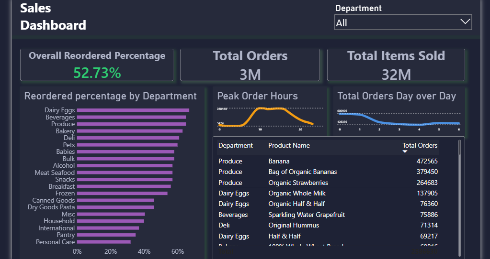
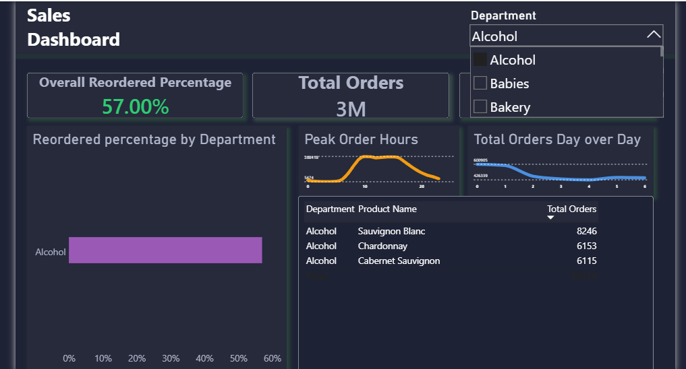
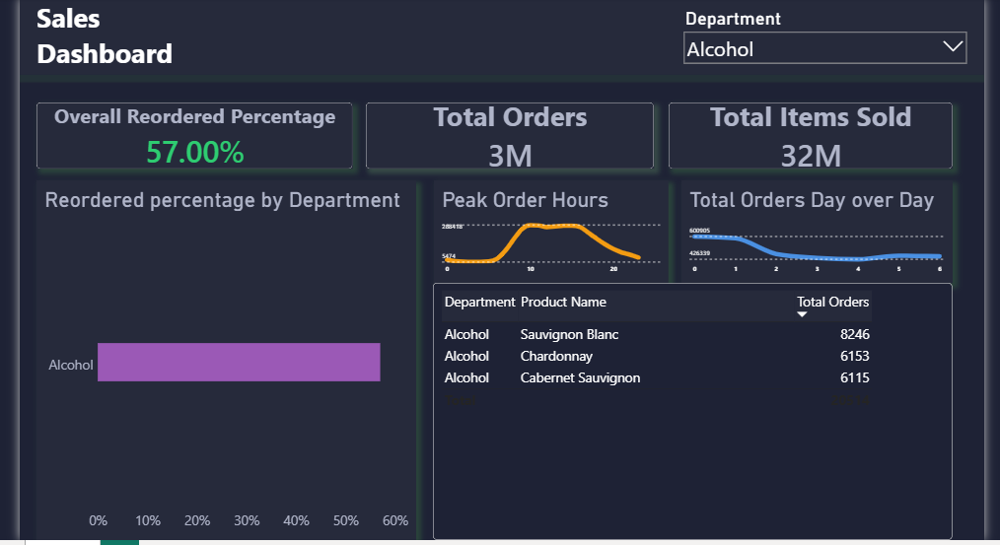

# Enterprise Sales Analytics: 32M Rows Optimization

## 📌 Executive Summary
Engineered an end-to-end data pipeline to process and analyze **32+ million sales records** and **3 million total orders**. Implemented a "Shift-Left" architecture by pushing heavy data transformations to PostgreSQL, resulting in a highly optimized, production-ready Power BI executive dashboard.

## 🛠️ Tech Stack
* **Database & ETL:** PostgreSQL, pgAdmin4
* **Business Intelligence:** Power BI
* **Key Techniques:** Shift-Left Architecture, SQL Window Functions, Data Modeling, DAX, Executive Formatting

## 🚀 Architecture & Performance Optimization (The "Shift-Left" Methodology)
To guarantee sub-second rendering times in Power BI and eliminate Power Query bottlenecks, I implemented a strict **Shift-Left architecture**. All heavy data processing, aggregations, and business logic were strategically pushed upstream to the PostgreSQL backend.

* **Advanced Database Engineering:** Processed the massive **32+ million row** dataset by architecting optimized SQL Views. Leveraged Common Table Expressions (CTEs), complex multi-table `JOIN`s, and `DENSE_RANK()` window functions to pre-aggregate data before it ever reaches the BI layer.
* **Targeted Indexing & Query Tuning:** Slashed complex query execution times to just **29 seconds** by deploying strategic B-Tree indexing (`CREATE INDEX`) on critical dimension keys and actively tuning the query planner using the `ANALYSE` command.
* **Robust Data Sanitization:** Cleansed raw data directly at the source—casting precise data types, resolving negative numeric anomalies (`ABS()`), filtering logical outliers, and harmonizing ambiguous legacy text strings into a unified 'Misc' category.
* **Ultra-Lightweight BI Model:** By completely offloading the computational overhead to the PostgreSQL engine, the Power BI data model only imports highly refined, business-ready dimensions. The result is an incredibly lean, lightning-fast `.pbix` file weighing **only 760 KB**.

## 📊 Dashboard Visuals

### 1. Executive Master View (Dark Teal Theme)
*(Reordered percentage highlights and seamless cross-filtering)*

### 2. Department-Level Slicer (Active Selection)
*(Demonstrating dynamic cross-filtering with drop-down active)*

### 3. Department-Level Slicer (Clean View)
*(Clean executive view after filter application)*

## 📂 Project Files
* **SQL Scripts:** Check `purchase_analytics.sql` in this repository for the advanced table structures, views, and index creations.
* **Power BI Dashboard:** The highly optimized **760 KB** `Sales Dashboard.pbix` file is uploaded directly in this repository. Feel free to download and interact with the data model!
